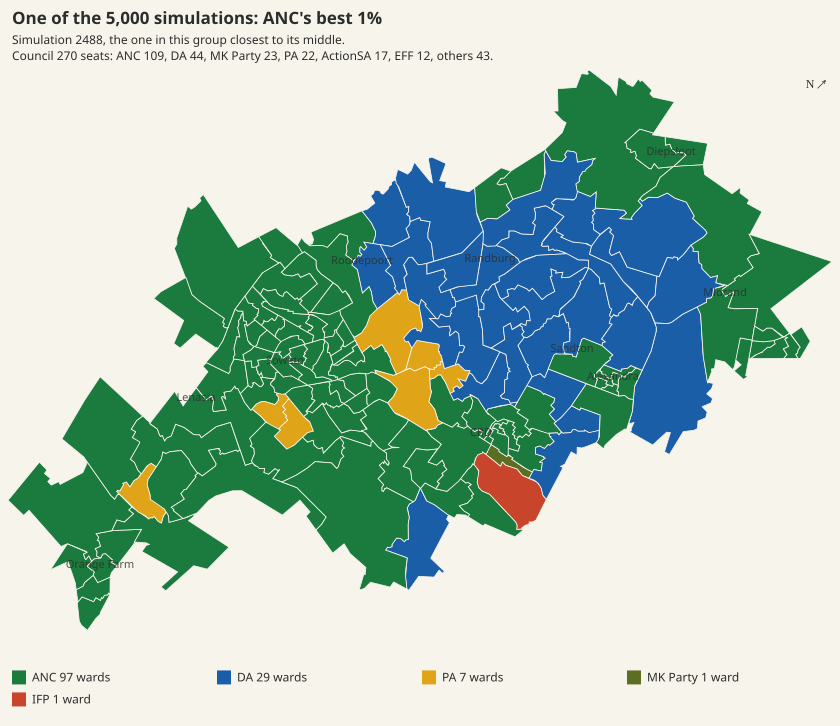
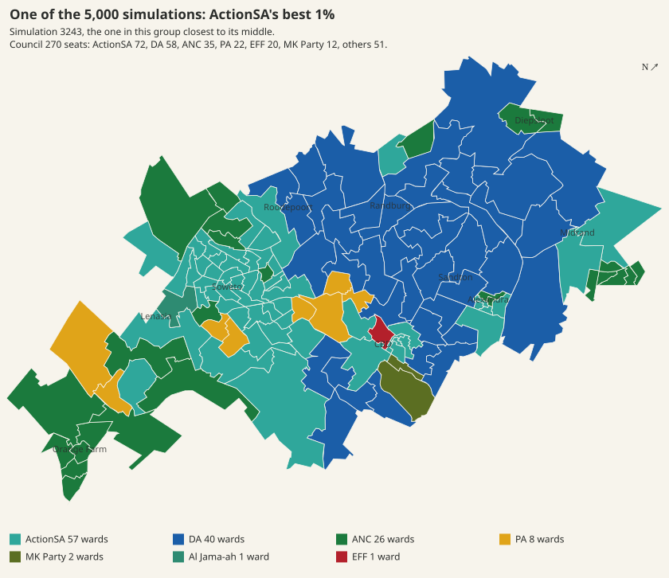
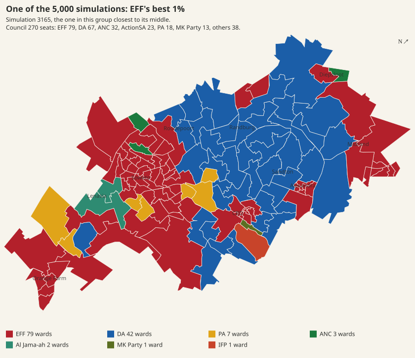
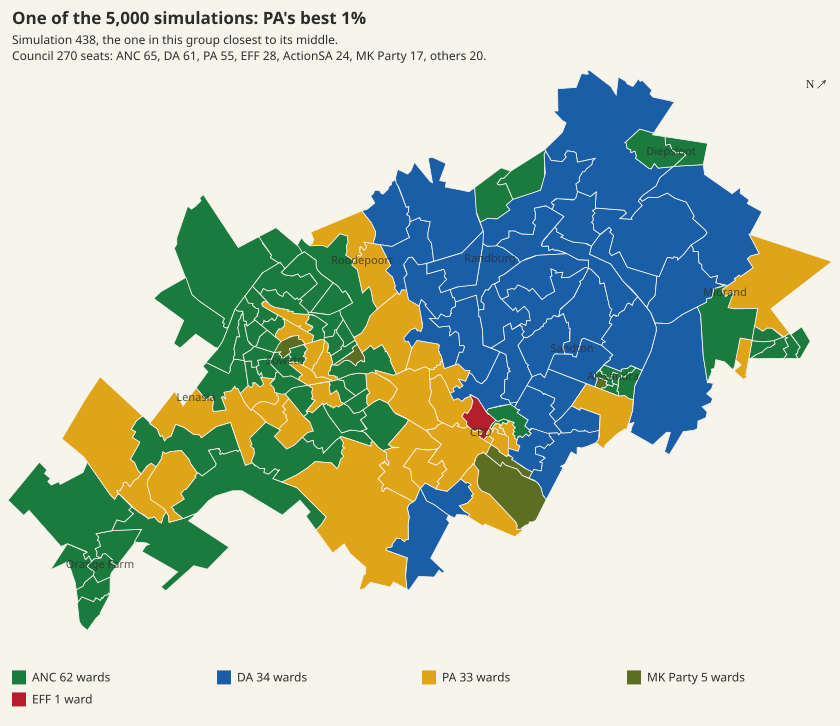
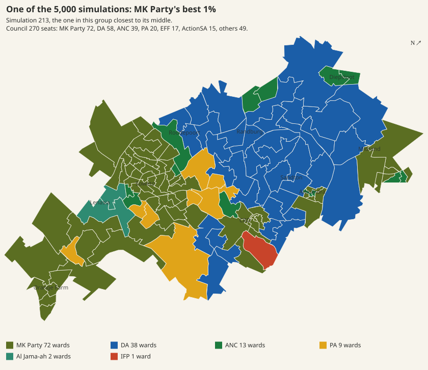
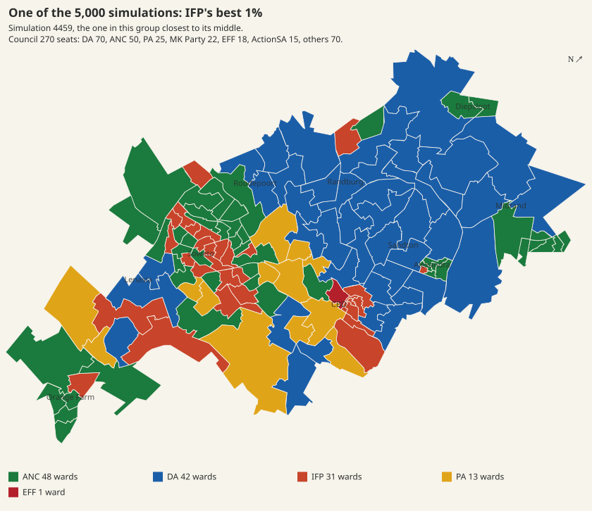
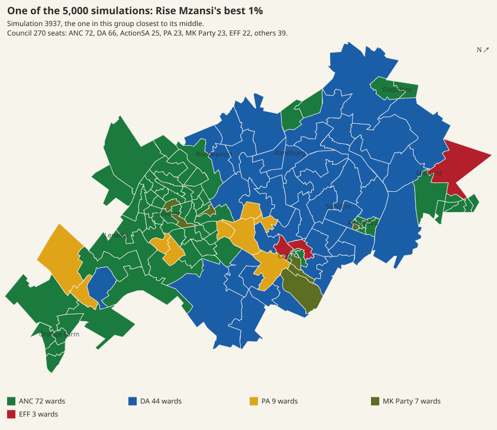
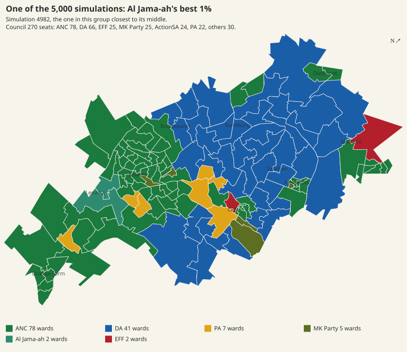

# Each party's best 1% of simulations, and what had to happen

Site batch item 8 (`../BEST-CASES-PACKET.md`), measured 2026-10-09. Analysis only: nothing here
changes a forecast, and no file outside this directory was written.

## Source and method

**Simulations.** The published run (`site/draws/manifest.json`, `published_run.model_run_id`
`r-c68c627d287e-5a52b360-dirty`, run 2026-09-29, published 2026-10-06): 5,000
simulations, seed 20261104, seat law `deduct`. Seats, ward winners, both ballots'
votes and the four turnouts come from `site/draws/base.bin`; ward and list seats
and the excessive-seats flag from `data/processed/seat_detail_draws.csv`. The two
files agree on every party's seats in every simulation and on every ward winner.

**Per-draw drivers the files lack** (the level shock, the within-group split, ward
noise, the turnout-pattern jitter) were recorded by an in-process `run_model` at
the published seed under `PYTHONHASHSEED=0`, with a transparent wrapper around the
random generator and around `log_shock` and `pool_spec` (`scripts/capture2.py`). It
reproduced the published file exactly: every ward winner, every party's whole votes
on both ballots, every pool turnout and every seat, in all 5,000 simulations. The
recorded drivers are therefore the ones the published simulations were made with.

**The best 1%.** For each party, the simulations in which its total seats are at
or above the seats of its 50th-best simulation. Ties at that cut are included, so
a group holds 50 to 66 simulations (50 to 58 for the nine parties treated in full); each table states the cut and the count.
Everything is compared with all 5,000 simulations.

**Coalitions** are counted simulation by simulation against that simulation's own
majority threshold (the council grows when excessive seats apply), never on the
group's medians, which describe no simulation. The representative simulation is
`scenarios.typical` applied to the group's seats for the six main parties.

**Places.** The repository names one area, Soweto (`content/joburg/areas.toml`).
Every other ward is labelled with the nearest place name on the `/forecast` map
(`cities/joburg.toml [map].labels`, by ward centroid in `ward_paths.json`). That
grouping is this analysis's own, made for reading the ward lists; it is not an
area the repository defines.

**Which parties.** The six named in the packet, plus every party whose 1% cut is
5 seats or more. That rule admits 31 further parties. IFP, Rise Mzansi and
Al Jama-ah, which the site already names (`scenarios.NAMED_PARTIES`), get the full
treatment and maps. The other 28 have a median of 0 or 1 seat across all 5,000
simulations and get one table row each (last section), because their best 1% has
one cause, described there.

## Variables: drawn and derived

The model draws these in every simulation (`montecarlo.make_drawer.draw_pools` and
the `run_model` loop):

| variable | how it is drawn | recorded in |
|---|---|---|
| citywide turnout factor | one standard normal | capture |
| turnout of each voter group (Black African, Coloured, Indian/Asian, White) | triangular band per group, tied to the citywide factor by a Gaussian copula | `base.bin` `pool_turnout` |
| level shock, every party | Student-t, multiplicative on the party's central level (`log_shock`), scaled by its `sd(log)` | capture |
| within-group split | one Dirichlet per voter group over its members, mean = the shocked and balanced shares, total concentration 16.3 (Black African) to 22.1 (White) | capture |
| turnout-pattern blend | uniform jitter of ±0.25 around 0.5 | capture |
| voting-district turnout noise | normal, sd 0.08, per voting district | capture (not analysed per ward) |
| ward noise | lognormal, sd 0.1, per ward and party | capture |
| new-party entrant | coin with p = 0.25 | inert in this run: the universe has no `ENTRANT`, and no draw was made |
| arrivals as a group | lognormal total and Dirichlet split | off in this scenario (`arrival_group_draw = false`) |

Everything else follows from those and is a consequence, not a cause:
each group's votes cast; each party's expected share within each group after the
level shock, the capacity cap and the balancing (IPF); the citywide list-ballot
and ward-ballot shares; per-district turnout; ward tallies and winners; ward seats;
the statutory entitlement; list seats; whether the excessive-seats clause applies;
council size and majority threshold; and every coalition outcome.

## What every party's best case has in common

For eight of the nine fully treated parties, the quantity that separates its best
1% from the rest is its own share **within a voter group** after the random
within-group split, more than turnout or its overall level. For the PA, its level
shock counts as much as the split. Across all 5,000
simulations, that split alone accounts for between 0.36 (PA) and 0.96 (IFP) of the
variance of a party's seats; its level shock for 0.03 to 0.37; the four turnouts
for 0.00 to 0.19 (R², each drawn quantity on its own). For the parties competing
for the Black African vote (ANC, ActionSA, EFF, MK Party, and the small parties),
the best 1%'s median split residual in the Black African group is between +17 and
+29 percentage points of that group's vote, and the group's mean residual sits at
the 98th percentile of all simulations or above.

The ward noise does not decide which wards change hands. In each party's gained
wards, its random ward factor minus the usual winner's averages between −1.0% and
+0.3% across its best 1%, against a spread of 13% to 14% in any one simulation.
Wards change hands because the group-level split moved, and the model's ward layer
carries that move into every voting district (`solve_and_predict`).

Two limits apply to every finding below. The within-group split is a random draw
with no named cause: the model has no campaign, candidate, event or local
variable, so it can say *which* voters moved in a party's best case but not *why*.
And the model is over-confident at ward level (`scenarios.py` docstring), so the
ward lists describe its mechanism, not which wards are likely to fall.

## Party by party

### ANC

**Findings.** In its best 1% of simulations, the 53 with 107 seats or more, the ANC wins 107 to 144 seats, with a median of 91 ward seats and 21 list seats. What these 53 share is the ANC's share of the Black African vote: a median of 70% in this group, against 36% across all 5,000 simulations. Its overall level was also drawn higher (a median of 18% above its central level), while turnout in each voter group was within 2 points of the all-simulation mean. The ANC is the largest party in all 53, holds a majority alone in 1, and holds one with the DA in all 53. The model draws how the Black African vote splits between parties at random, and has no campaign, candidate or event variable that would say why the ANC's share rises.

Best 1%: the **53** simulations with **107 seats or more** (out of 5,000; ties at the cut included). Seats in this group: 107 to 144, median 112; median across all 5,000: 66.

| seats | median, best 1% | range, best 1% | median, all 5,000 |
|---|---|---|---|
| ward seats | 91 | 83 to 122 | 66 |
| list seats | 21 | 12 to 36 | 0 |

| excessive-seats clause fired | share of best 1% | share of all 5,000 |
|---|---|---|
| for ANC | 0% | 62.3% |
| for any other party | 0% | 9% |

Other parties it fired for in the best 1% (simulations): none.

Largest party in the best 1% (simulations): ANC 53.

| coalition of named parties | reaches a majority, best 1% | needs every member, best 1% | reaches a majority, all 5,000 |
|---|---|---|---|
| ANC + DA | 100% | 98% | 43% |
| ANC + PA | 51% | 49% | 1% |
| ANC + ActionSA + MK Party | 91% | 43% | 16% |
| ANC + EFF + MK Party | 81% | 43% | 12% |
| ANC + ActionSA + EFF | 89% | 42% | 21% |
| ANC + ActionSA | 40% | 38% | 1% |
| ANC + ActionSA + PA | 100% | 36% | 18% |
| ANC + EFF + PA | 91% | 36% | 14% |
| ANC + PA + MK Party | 91% | 32% | 10% |
| ANC + MK Party | 28% | 26% | 1% |
| ANC + EFF | 19% | 17% | 1% |

Coalitions listed: those of one to three of the six main parties in which every member is needed for the majority in at least 10% of the best 1%. A majority is each simulation's own threshold (council size varies with excessive seats).

Representative simulation **2488** (closest to the best 1%'s median seats of the six main parties, `scenarios.typical` on the group): ANC 109, DA 44, MK Party 23, PA 22, ActionSA 17, EFF 12, others 43; council 270, majority 136. Majorities needing every member in it: ANC + DA, ANC + ActionSA + EFF, ANC + ActionSA + PA, ANC + ActionSA + MK Party, ANC + EFF + PA, ANC + EFF + MK Party, ANC + PA + MK Party. Best 1% medians, for comparison: ANC 112, DA 53, PA 22, ActionSA 19, MK Party 16, EFF 12.

| list-ballot share, pp | median, best 1% | median, all 5,000 | ward-ballot share, median best 1% | median, all 5,000 |
|---|---|---|---|---|
| ANC | 42.7 | 21.7 | 40.9 | 20.9 |
| ActionSA | 8.2 | 11.7 | 6.1 | 8.5 |
| DA | 19.8 | 25.2 | 19.6 | 25.0 |
| EFF | 4.5 | 9.2 | 4.6 | 9.5 |
| MK Party | 6.4 | 8.7 | 5.7 | 7.8 |
| PA | 5.6 | 6.1 | 10.6 | 11.5 |

| turnout by voter group (drawn), % | mean, best 1% | mean, all 5,000 | best 1% mean as percentile of all |
|---|---|---|---|
| Black African | 37.9 | 37.3 | 55 |
| Coloured | 51.8 | 53.1 | 45 |
| Indian/Asian | 42.9 | 44.6 | 48 |
| White | 50.6 | 52.3 | 42 |

| level shock (drawn): % above or below the party's central level | median, best 1% | 10th to 90th pct, best 1% | median, all 5,000 | sd(log) of the shock |
|---|---|---|---|---|
| ANC (central level 25.8% of the list vote) | +18 | -1 to +60 | +0 | 0.15 |
| ActionSA (central level 14.6% of the list vote) | -2 | -21 to +19 | +0 | 0.17 |
| DA (central level 30.1% of the list vote) | -3 | -16 to +20 | +0 | 0.15 |
| EFF (central level 11.7% of the list vote) | +1 | -18 to +16 | +0 | 0.15 |
| MK Party (central level 11.1% of the list vote) | +2 | -14 to +16 | -0 | 0.15 |
| PA (central level 7.6% of the list vote) | -3 | -22 to +38 | +1 | 0.21 |

| ANC's share within each voter group, % of that group's vote | expected after the level shock, median best 1% | same, all 5,000 | drawn (after the within-group split), median best 1% | same, all 5,000 | split residual, median best 1%, pp |
|---|---|---|---|---|---|
| Black African | 41.9 | 36.6 | 69.9 | 36.1 | +28.7 |
| Coloured | 2.7 | 1.4 | 1.4 | 0.3 | -0.3 |
| Indian/Asian | 10.4 | 7.8 | 12.7 | 6.6 | +0.2 |
| White | 3.8 | 2.5 | 3.4 | 1.3 | -0.3 |

Share of the variance of ANC's seats across all 5,000 simulations accounted for by each drawn quantity alone (least squares, R²): its within-group split 0.75; its level shock 0.12; the six main parties' level shocks 0.14; the four turnouts 0.01; the turnout-pattern blend 0.00; all of these together 0.91. The remainder (rivals' within-group splits, the interactions through the balancing step and the seat law, district turnout noise and ward noise) is not decomposed here.

Wards ANC wins in at least half of its best 1% and in under half of all 5,000: **24**. By position: near CBD 9, near Lenasia 4, Soweto 4, near Midrand 3, near Alexandra 2, near Diepsloot 1, near Roodepoort 1. Each ward's most frequent winner across all 5,000: DA 7, MK Party 7, PA 4, ANC 4, EFF 2.

| ward | where | won, all 5,000 | won, best 1% | most frequent winner, all 5,000 |
|---|---|---|---|---|
| 60 | near CBD | 7% | 91% | EFF |
| 92 | near Midrand | 18% | 98% | DA |
| 123 | near CBD | 16% | 96% | MK Party |
| 96 | near Diepsloot | 8% | 85% | DA |
| 124 | near CBD | 23% | 100% | PA |
| 75 | near Alexandra | 19% | 96% | MK Party |
| 125 | near CBD | 5% | 79% | PA |
| 81 | near Alexandra | 25% | 98% | DA |
| 71 | near Roodepoort | 5% | 77% | DA |
| 67 | near CBD | 28% | 100% | EFF |
| 9 | near Lenasia | 30% | 100% | DA |
| 121 | near Lenasia | 30% | 100% | PA |
| 59 | near CBD | 34% | 100% | MK Party |
| 29 | near CBD | 30% | 96% | PA |
| 112 | near Midrand | 3% | 68% | DA |
| 63 | near CBD | 35% | 100% | MK Party |
| 34 | Soweto | 37% | 100% | MK Party |
| 64 | near CBD | 38% | 100% | ANC |
| 37 | Soweto | 36% | 98% | MK Party |
| 40 | Soweto | 40% | 100% | MK Party |
| 10 | near Lenasia | 43% | 100% | ANC |
| 120 | near Lenasia | 42% | 98% | DA |
| 110 | near Midrand | 48% | 100% | ANC |
| 38 | Soweto | 50% | 100% | ANC |

Ward noise (drawn) in these wards: ANC's random ward factor minus the most frequent winner's averaged -0.6% across the best 1%, against a spread of 13% (sd of the log difference) in any one simulation.

Maps: `anc-representative.svg`, `anc-ward-frequency.svg`.

### DA

**Findings.** In its best 1%, the 52 simulations with 104 seats or more, the DA wins 104 to 174 seats, with a median of 75 ward seats and 38 list seats. Three drawn quantities are favourable together: its overall level (a median of 22% above its central level), its share of the Black African vote (a median of 21% in this group against 1% across all simulations), and turnout, which averages about 2 points higher among White and Indian/Asian voters and 1.4 points lower among Black African voters. It is the largest party in all 52 and holds a majority alone in 3. It gains 32 wards it wins in under half of all simulations; the ANC is the most frequent winner of 20 of them. The model draws the DA's share of the Black African vote at random and holds nothing that would produce that shift.

Best 1%: the **52** simulations with **104 seats or more** (out of 5,000; ties at the cut included). Seats in this group: 104 to 174, median 110; median across all 5,000: 66.

| seats | median, best 1% | range, best 1% | median, all 5,000 |
|---|---|---|---|
| ward seats | 75 | 50 to 134 | 42 |
| list seats | 38 | 0 to 57 | 24 |

| excessive-seats clause fired | share of best 1% | share of all 5,000 |
|---|---|---|
| for DA | 4% | 0.1% |
| for any other party | 46% | 70% |

Other parties it fired for in the best 1% (simulations): ANC 23, IFP 2, EFF 1.

Largest party in the best 1% (simulations): DA 52.

| coalition of named parties | reaches a majority, best 1% | needs every member, best 1% | reaches a majority, all 5,000 |
|---|---|---|---|
| ANC + DA | 92% | 87% | 43% |
| DA + EFF | 48% | 42% | 3% |
| DA + ActionSA | 44% | 38% | 2% |
| DA + PA | 42% | 37% | 1% |
| DA + MK Party | 42% | 37% | 2% |
| DA + PA + MK Party | 90% | 37% | 14% |
| DA + ActionSA + PA | 94% | 33% | 16% |
| DA + EFF + PA | 85% | 25% | 17% |
| DA + ActionSA + MK Party | 87% | 23% | 20% |
| DA + EFF + MK Party | 85% | 19% | 21% |
| DA + ActionSA + EFF | 90% | 17% | 24% |

Coalitions listed: those of one to three of the six main parties in which every member is needed for the majority in at least 10% of the best 1%. A majority is each simulation's own threshold (council size varies with excessive seats).

Representative simulation **2938** (closest to the best 1%'s median seats of the six main parties, `scenarios.typical` on the group): DA 108, ANC 48, MK Party 21, PA 19, ActionSA 17, EFF 16, others 41; council 270, majority 136. Majorities needing every member in it: ANC + DA, DA + ActionSA + EFF, DA + ActionSA + PA, DA + ActionSA + MK Party, DA + EFF + PA, DA + EFF + MK Party, DA + PA + MK Party. Best 1% medians, for comparison: DA 110, ANC 43.5, ActionSA 20, PA 20, MK Party 17.5, EFF 17.

| list-ballot share, pp | median, best 1% | median, all 5,000 | ward-ballot share, median best 1% | median, all 5,000 |
|---|---|---|---|---|
| DA | 42.0 | 25.2 | 41.3 | 25.0 |
| ANC | 15.8 | 21.7 | 15.2 | 20.9 |
| ActionSA | 8.6 | 11.7 | 6.2 | 8.5 |
| EFF | 6.3 | 9.2 | 6.4 | 9.5 |
| MK Party | 7.0 | 8.7 | 6.2 | 7.8 |
| PA | 5.1 | 6.1 | 9.7 | 11.5 |

| turnout by voter group (drawn), % | mean, best 1% | mean, all 5,000 | best 1% mean as percentile of all |
|---|---|---|---|
| Black African | 35.9 | 37.3 | 42 |
| Coloured | 51.8 | 53.1 | 45 |
| Indian/Asian | 46.2 | 44.6 | 56 |
| White | 54.4 | 52.3 | 59 |

| level shock (drawn): % above or below the party's central level | median, best 1% | 10th to 90th pct, best 1% | median, all 5,000 | sd(log) of the shock |
|---|---|---|---|---|
| DA (central level 30.1% of the list vote) | +22 | -0 to +56 | +0 | 0.15 |
| ANC (central level 25.8% of the list vote) | -5 | -22 to +11 | +0 | 0.15 |
| ActionSA (central level 14.6% of the list vote) | -2 | -27 to +20 | +0 | 0.17 |
| EFF (central level 11.7% of the list vote) | +2 | -19 to +17 | +0 | 0.15 |
| MK Party (central level 11.1% of the list vote) | -1 | -21 to +17 | -0 | 0.15 |
| PA (central level 7.6% of the list vote) | -4 | -27 to +34 | +1 | 0.21 |

| DA's share within each voter group, % of that group's vote | expected after the level shock, median best 1% | same, all 5,000 | drawn (after the within-group split), median best 1% | same, all 5,000 | split residual, median best 1%, pp |
|---|---|---|---|---|---|
| Black African | 4.1 | 2.6 | 20.7 | 1.1 | +15.2 |
| Coloured | 10.3 | 5.1 | 7.5 | 3.6 | -0.8 |
| Indian/Asian | 47.0 | 36.3 | 51.1 | 36.2 | +2.5 |
| White | 76.6 | 67.7 | 87.2 | 68.5 | +9.6 |

Share of the variance of DA's seats across all 5,000 simulations accounted for by each drawn quantity alone (least squares, R²): its within-group split 0.54; its level shock 0.27; the six main parties' level shocks 0.31; the four turnouts 0.12; the turnout-pattern blend 0.00; all of these together 0.97. The remainder (rivals' within-group splits, the interactions through the balancing step and the seat law, district turnout noise and ward noise) is not decomposed here.

Wards DA wins in at least half of its best 1% and in under half of all 5,000: **32**. By position: near CBD 12, near Lenasia 5, Soweto 5, near Orange Farm 4, near Midrand 3, near Randburg 2, near Roodepoort 1. Each ward's most frequent winner across all 5,000: ANC 20, PA 5, DA 3, EFF 2, MK Party 2.

| ward | where | won, all 5,000 | won, best 1% | most frequent winner, all 5,000 |
|---|---|---|---|---|
| 2 | near Orange Farm | 6% | 92% | ANC |
| 124 | near CBD | 15% | 98% | PA |
| 64 | near CBD | 4% | 87% | ANC |
| 127 | near Roodepoort | 4% | 85% | ANC |
| 67 | near CBD | 18% | 98% | EFF |
| 110 | near Midrand | 25% | 100% | ANC |
| 68 | near CBD | 5% | 81% | PA |
| 10 | near Lenasia | 21% | 96% | ANC |
| 80 | near Midrand | 2% | 75% | ANC |
| 100 | near Randburg | 2% | 75% | ANC |
| 69 | near CBD | 26% | 98% | PA |
| 1 | near Orange Farm | 2% | 71% | ANC |
| 58 | near CBD | 32% | 100% | ANC |
| 8 | near Lenasia | 2% | 69% | ANC |
| 62 | near CBD | 1% | 65% | ANC |
| 4 | near Orange Farm | 1% | 65% | ANC |
| 114 | near Randburg | 2% | 65% | ANC |
| 9 | near Lenasia | 37% | 100% | DA |
| 59 | near CBD | 1% | 63% | MK Party |
| 14 | Soweto | 1% | 63% | ANC |
| 92 | near Midrand | 38% | 100% | DA |
| 125 | near CBD | 39% | 100% | PA |
| 39 | Soweto | 1% | 60% | ANC |
| 11 | Soweto | 2% | 60% | ANC |
| 123 | near CBD | 2% | 60% | MK Party |
| 82 | near CBD | 3% | 60% | PA |
| 60 | near CBD | 2% | 56% | EFF |
| 120 | near Lenasia | 47% | 100% | DA |
| 135 | Soweto | 1% | 54% | ANC |
| 3 | near Orange Farm | 1% | 54% | ANC |
| 47 | Soweto | 1% | 50% | ANC |
| 119 | near Lenasia | 1% | 50% | ANC |

Ward noise (drawn) in these wards: DA's random ward factor minus the most frequent winner's averaged +0.2% across the best 1%, against a spread of 13% (sd of the log difference) in any one simulation.

Maps: `da-representative.svg`, `da-ward-frequency.svg`.

### ActionSA

**Findings.** In its best 1%, the 50 simulations with 68 seats or more, ActionSA wins 68 to 91 seats, with a median of 49.5 ward seats and 26.5 list seats. These simulations share ActionSA's share of the Black African vote, a median of 43% in this group against 12% across all simulations; its overall level was drawn a median 14% above its central level, and turnout was within a point of the all-simulation mean in every voter group. It is the largest party in 43 of the 50, and it and the DA together hold a majority in 24 (48%). It gains 54 wards it wins in under half of all simulations: 35 are in Soweto and the ANC is the most frequent winner of 40. The model has no variable for why Black African voters would move to ActionSA; the split is drawn at random.

Best 1%: the **50** simulations with **68 seats or more** (out of 5,000; ties at the cut included). Seats in this group: 68 to 91, median 74.5; median across all 5,000: 27.

| seats | median, best 1% | range, best 1% | median, all 5,000 |
|---|---|---|---|
| ward seats | 49.5 | 13 to 77 | 0 |
| list seats | 26.5 | 3 to 56 | 26 |

| excessive-seats clause fired | share of best 1% | share of all 5,000 |
|---|---|---|
| for ActionSA | 0% | 0.0% |
| for any other party | 22% | 70% |

Other parties it fired for in the best 1% (simulations): ANC 11.

Largest party in the best 1% (simulations): ActionSA 43, DA 7.

| coalition of named parties | reaches a majority, best 1% | needs every member, best 1% | reaches a majority, all 5,000 |
|---|---|---|---|
| ANC + DA + ActionSA | 100% | 50% | 86% |
| ANC + ActionSA + EFF | 60% | 50% | 21% |
| DA + ActionSA | 48% | 48% | 2% |
| ANC + ActionSA + PA | 56% | 46% | 18% |
| DA + ActionSA + PA | 92% | 44% | 16% |
| DA + ActionSA + MK Party | 92% | 44% | 20% |
| ANC + ActionSA + MK Party | 52% | 42% | 16% |
| DA + ActionSA + EFF | 84% | 36% | 24% |
| ANC + DA + PA | 34% | 32% | 81% |
| ANC + DA + EFF | 14% | 12% | 86% |
| ANC + ActionSA | 10% | 10% | 1% |
| ActionSA + EFF + PA | 10% | 10% | 1% |

Coalitions listed: those of one to three of the six main parties in which every member is needed for the majority in at least 10% of the best 1%. A majority is each simulation's own threshold (council size varies with excessive seats).

Representative simulation **3243** (closest to the best 1%'s median seats of the six main parties, `scenarios.typical` on the group): ActionSA 72, DA 58, ANC 35, PA 22, EFF 20, MK Party 12, others 51; council 270, majority 136. Majorities needing every member in it: ANC + DA + ActionSA, DA + ActionSA + EFF, DA + ActionSA + PA, DA + ActionSA + MK Party. Best 1% medians, for comparison: ActionSA 74.5, DA 58.5, ANC 41, PA 23, EFF 17, MK Party 15.5.

| list-ballot share, pp | median, best 1% | median, all 5,000 | ward-ballot share, median best 1% | median, all 5,000 |
|---|---|---|---|---|
| ActionSA | 31.2 | 11.7 | 24.0 | 8.5 |
| ANC | 15.0 | 21.7 | 15.2 | 20.9 |
| DA | 21.3 | 25.2 | 22.1 | 25.0 |
| EFF | 5.8 | 9.2 | 6.4 | 9.5 |
| MK Party | 5.9 | 8.7 | 5.6 | 7.8 |
| PA | 5.7 | 6.1 | 11.3 | 11.5 |

| turnout by voter group (drawn), % | mean, best 1% | mean, all 5,000 | best 1% mean as percentile of all |
|---|---|---|---|
| Black African | 37.9 | 37.3 | 56 |
| Coloured | 54.0 | 53.1 | 52 |
| Indian/Asian | 44.4 | 44.6 | 51 |
| White | 52.2 | 52.3 | 50 |

| level shock (drawn): % above or below the party's central level | median, best 1% | 10th to 90th pct, best 1% | median, all 5,000 | sd(log) of the shock |
|---|---|---|---|---|
| ActionSA (central level 14.6% of the list vote) | +14 | -7 to +60 | +0 | 0.17 |
| ANC (central level 25.8% of the list vote) | -4 | -14 to +14 | +0 | 0.15 |
| DA (central level 30.1% of the list vote) | -5 | -23 to +12 | +0 | 0.15 |
| EFF (central level 11.7% of the list vote) | -2 | -16 to +22 | +0 | 0.15 |
| MK Party (central level 11.1% of the list vote) | -3 | -27 to +14 | -0 | 0.15 |
| PA (central level 7.6% of the list vote) | -2 | -22 to +17 | +1 | 0.21 |

| ActionSA's share within each voter group, % of that group's vote | expected after the level shock, median best 1% | same, all 5,000 | drawn (after the within-group split), median best 1% | same, all 5,000 | split residual, median best 1%, pp |
|---|---|---|---|---|---|
| Black African | 16.4 | 13.9 | 42.6 | 12.3 | +26.2 |
| Coloured | 1.0 | 0.8 | 0.0 | 0.0 | -0.5 |
| Indian/Asian | 22.5 | 19.1 | 22.1 | 18.1 | -2.0 |
| White | 13.4 | 11.2 | 17.4 | 10.0 | +4.8 |

Share of the variance of ActionSA's seats across all 5,000 simulations accounted for by each drawn quantity alone (least squares, R²): its within-group split 0.85; its level shock 0.12; the six main parties' level shocks 0.13; the four turnouts 0.00; the turnout-pattern blend 0.00; all of these together 0.99. The remainder (rivals' within-group splits, the interactions through the balancing step and the seat law, district turnout noise and ward noise) is not decomposed here.

Wards ActionSA wins in at least half of its best 1% and in under half of all 5,000: **54**. By position: Soweto 35, near CBD 9, near Midrand 3, near Lenasia 3, near Alexandra 2, near Roodepoort 1, near Randburg 1. Each ward's most frequent winner across all 5,000: ANC 40, MK Party 6, DA 4, EFF 2, PA 2.

| ward | where | won, all 5,000 | won, best 1% | most frequent winner, all 5,000 |
|---|---|---|---|---|
| 14 | Soweto | 6% | 96% | ANC |
| 25 | Soweto | 7% | 96% | ANC |
| 135 | Soweto | 8% | 96% | ANC |
| 67 | near CBD | 4% | 90% | EFF |
| 59 | near CBD | 4% | 90% | MK Party |
| 92 | near Midrand | 4% | 88% | DA |
| 48 | Soweto | 5% | 88% | ANC |
| 31 | Soweto | 5% | 86% | ANC |
| 13 | Soweto | 7% | 88% | ANC |
| 62 | near CBD | 3% | 84% | ANC |
| 27 | Soweto | 4% | 84% | ANC |
| 38 | Soweto | 5% | 84% | ANC |
| 39 | Soweto | 3% | 82% | ANC |
| 120 | near Lenasia | 3% | 80% | DA |
| 34 | Soweto | 3% | 80% | MK Party |
| 130 | Soweto | 3% | 78% | ANC |
| 16 | Soweto | 4% | 78% | ANC |
| 22 | Soweto | 4% | 78% | ANC |
| 24 | near Lenasia | 3% | 76% | ANC |
| 40 | Soweto | 2% | 72% | MK Party |
| 64 | near CBD | 2% | 72% | ANC |
| 119 | near Lenasia | 2% | 72% | ANC |
| 47 | Soweto | 4% | 74% | ANC |
| 52 | Soweto | 3% | 72% | ANC |
| 30 | Soweto | 4% | 72% | ANC |
| 110 | near Midrand | 2% | 70% | ANC |
| 37 | Soweto | 2% | 70% | MK Party |
| 36 | Soweto | 2% | 70% | ANC |
| 123 | near CBD | 2% | 70% | MK Party |
| 60 | near CBD | 3% | 70% | EFF |
| 81 | near Alexandra | 2% | 68% | DA |
| 46 | Soweto | 2% | 66% | ANC |
| 124 | near CBD | 2% | 64% | PA |
| 51 | Soweto | 2% | 64% | ANC |
| 11 | Soweto | 1% | 62% | ANC |
| 63 | near CBD | 1% | 62% | MK Party |
| 45 | Soweto | 2% | 62% | ANC |
| 33 | Soweto | 2% | 62% | ANC |
| 127 | near Roodepoort | 2% | 62% | ANC |
| 15 | Soweto | 2% | 62% | ANC |
| 105 | near Alexandra | 2% | 62% | ANC |
| 125 | near CBD | 2% | 60% | PA |
| 21 | Soweto | 2% | 60% | ANC |
| 20 | Soweto | 3% | 60% | ANC |
| 19 | Soweto | 2% | 58% | ANC |
| 28 | Soweto | 2% | 58% | ANC |
| 35 | Soweto | 2% | 58% | ANC |
| 49 | Soweto | 1% | 56% | ANC |
| 53 | Soweto | 2% | 56% | ANC |
| 100 | near Randburg | 1% | 52% | ANC |
| 44 | Soweto | 1% | 52% | ANC |
| 42 | Soweto | 2% | 52% | ANC |
| 41 | Soweto | 2% | 52% | ANC |
| 112 | near Midrand | 2% | 52% | DA |

Ward noise (drawn) in these wards: ActionSA's random ward factor minus the most frequent winner's averaged -0.2% across the best 1%, against a spread of 14% (sd of the log difference) in any one simulation.

Maps: `asa-representative.svg`, `asa-ward-frequency.svg`.

### EFF

**Findings.** In its best 1%, the 53 simulations with 73 seats or more, the EFF wins 73 to 97 seats, with a median of 77 ward seats and no list seats: in 75% of these simulations it wins more wards than its vote entitles it to, and the excessive-seats clause applies to it. Its share of the Black African vote is a median of 45% in this group against 15% across all simulations; its overall level was drawn a median 8% above its central level, and turnout was within about a point of the all-simulation mean. It is the largest party in 48 of the 53, and it and the DA together hold a majority in 42 (79%). It gains 81 wards it wins in under half of all simulations; the ANC is the most frequent winner of 67, and 40 are in Soweto. The model gives no reason for the shift: it is a random draw of how Black African voters split.

Best 1%: the **53** simulations with **73 seats or more** (out of 5,000; ties at the cut included). Seats in this group: 73 to 97, median 79; median across all 5,000: 25.

| seats | median, best 1% | range, best 1% | median, all 5,000 |
|---|---|---|---|
| ward seats | 77 | 40 to 97 | 2 |
| list seats | 0 | 0 to 33 | 19 |

| excessive-seats clause fired | share of best 1% | share of all 5,000 |
|---|---|---|
| for EFF | 75% | 2.7% |
| for any other party | 8% | 67% |

Other parties it fired for in the best 1% (simulations): IFP 3, Al Jama-ah 1.

Largest party in the best 1% (simulations): EFF 48, DA 5.

| coalition of named parties | reaches a majority, best 1% | needs every member, best 1% | reaches a majority, all 5,000 |
|---|---|---|---|
| DA + EFF | 79% | 79% | 3% |
| ANC + ActionSA + EFF | 64% | 60% | 21% |
| ANC + EFF + PA | 49% | 45% | 14% |
| ActionSA + EFF + PA | 34% | 34% | 1% |
| ANC + EFF + MK Party | 32% | 28% | 12% |
| DA + EFF + PA | 100% | 21% | 17% |
| ANC + DA + EFF | 100% | 19% | 86% |
| DA + ActionSA + EFF | 98% | 19% | 24% |
| ActionSA + EFF + MK Party | 19% | 19% | 1% |
| ANC + DA + ActionSA | 17% | 17% | 86% |
| DA + EFF + MK Party | 96% | 17% | 21% |
| ANC + DA + PA | 11% | 11% | 81% |

Coalitions listed: those of one to three of the six main parties in which every member is needed for the majority in at least 10% of the best 1%. A majority is each simulation's own threshold (council size varies with excessive seats).

Representative simulation **3165** (closest to the best 1%'s median seats of the six main parties, `scenarios.typical` on the group): EFF 79, DA 67, ANC 32, ActionSA 23, PA 18, MK Party 13, others 38; council 270, majority 136. Majorities needing every member in it: DA + EFF. Best 1% medians, for comparison: EFF 79, DA 65, ANC 32, ActionSA 26, PA 21, MK Party 15.

| list-ballot share, pp | median, best 1% | median, all 5,000 | ward-ballot share, median best 1% | median, all 5,000 |
|---|---|---|---|---|
| EFF | 27.0 | 9.2 | 27.1 | 9.5 |
| ANC | 12.6 | 21.7 | 12.0 | 20.9 |
| ActionSA | 11.5 | 11.7 | 8.3 | 8.5 |
| DA | 24.5 | 25.2 | 23.8 | 25.0 |
| MK Party | 6.1 | 8.7 | 5.2 | 7.8 |
| PA | 5.7 | 6.1 | 10.6 | 11.5 |

| turnout by voter group (drawn), % | mean, best 1% | mean, all 5,000 | best 1% mean as percentile of all |
|---|---|---|---|
| Black African | 37.6 | 37.3 | 54 |
| Coloured | 54.2 | 53.1 | 53 |
| Indian/Asian | 45.8 | 44.6 | 55 |
| White | 52.0 | 52.3 | 48 |

| level shock (drawn): % above or below the party's central level | median, best 1% | 10th to 90th pct, best 1% | median, all 5,000 | sd(log) of the shock |
|---|---|---|---|---|
| EFF (central level 11.7% of the list vote) | +8 | -7 to +31 | +0 | 0.15 |
| ANC (central level 25.8% of the list vote) | -6 | -19 to +8 | +0 | 0.15 |
| ActionSA (central level 14.6% of the list vote) | +1 | -13 to +18 | +0 | 0.17 |
| DA (central level 30.1% of the list vote) | +1 | -13 to +17 | +0 | 0.15 |
| MK Party (central level 11.1% of the list vote) | -2 | -16 to +16 | -0 | 0.15 |
| PA (central level 7.6% of the list vote) | -4 | -20 to +23 | +1 | 0.21 |

| EFF's share within each voter group, % of that group's vote | expected after the level shock, median best 1% | same, all 5,000 | drawn (after the within-group split), median best 1% | same, all 5,000 | split residual, median best 1%, pp |
|---|---|---|---|---|---|
| Black African | 17.8 | 16.3 | 44.6 | 15.0 | +27.6 |
| Coloured | 0.4 | 0.3 | 0.0 | 0.0 | -0.3 |
| Indian/Asian | 0.5 | 0.5 | 0.0 | 0.0 | -0.5 |
| White | 2.2 | 2.1 | 1.5 | 0.9 | -0.9 |

Share of the variance of EFF's seats across all 5,000 simulations accounted for by each drawn quantity alone (least squares, R²): its within-group split 0.90; its level shock 0.06; the six main parties' level shocks 0.07; the four turnouts 0.01; the turnout-pattern blend 0.00; all of these together 0.98. The remainder (rivals' within-group splits, the interactions through the balancing step and the seat law, district turnout noise and ward noise) is not decomposed here.

Wards EFF wins in at least half of its best 1% and in under half of all 5,000: **81**. By position: Soweto 40, near Midrand 9, near Alexandra 7, near Orange Farm 7, near CBD 7, near Lenasia 5, near Randburg 2, near Roodepoort 2, near Diepsloot 2. Each ward's most frequent winner across all 5,000: ANC 67, MK Party 7, DA 5, PA 1, EFF 1.

| ward | where | won, all 5,000 | won, best 1% | most frequent winner, all 5,000 |
|---|---|---|---|---|
| 130 | Soweto | 5% | 100% | ANC |
| 30 | Soweto | 6% | 98% | ANC |
| 53 | Soweto | 7% | 98% | ANC |
| 31 | Soweto | 8% | 98% | ANC |
| 21 | Soweto | 8% | 98% | ANC |
| 47 | Soweto | 8% | 98% | ANC |
| 36 | Soweto | 4% | 94% | ANC |
| 119 | near Lenasia | 8% | 98% | ANC |
| 76 | near Alexandra | 7% | 96% | ANC |
| 20 | Soweto | 5% | 94% | ANC |
| 26 | Soweto | 5% | 94% | ANC |
| 14 | Soweto | 9% | 98% | ANC |
| 8 | near Lenasia | 3% | 92% | ANC |
| 45 | Soweto | 5% | 94% | ANC |
| 78 | near Midrand | 7% | 96% | ANC |
| 22 | Soweto | 7% | 96% | ANC |
| 79 | near Midrand | 11% | 100% | ANC |
| 48 | Soweto | 11% | 100% | ANC |
| 33 | Soweto | 8% | 96% | ANC |
| 2 | near Orange Farm | 8% | 96% | ANC |
| 13 | Soweto | 12% | 100% | ANC |
| 49 | Soweto | 12% | 100% | ANC |
| 39 | Soweto | 3% | 91% | ANC |
| 107 | near Alexandra | 12% | 100% | ANC |
| 133 | near Midrand | 12% | 100% | ANC |
| 114 | near Randburg | 10% | 98% | ANC |
| 24 | near Lenasia | 10% | 98% | ANC |
| 25 | Soweto | 11% | 98% | ANC |
| 108 | near Alexandra | 12% | 100% | ANC |
| 5 | near Orange Farm | 3% | 91% | ANC |
| 105 | near Alexandra | 13% | 100% | ANC |
| 77 | near Midrand | 13% | 100% | ANC |
| 27 | Soweto | 13% | 100% | ANC |
| 41 | Soweto | 4% | 91% | ANC |
| 100 | near Randburg | 6% | 92% | ANC |
| 52 | Soweto | 4% | 91% | ANC |
| 3 | near Orange Farm | 2% | 89% | ANC |
| 38 | Soweto | 3% | 89% | ANC |
| 42 | Soweto | 3% | 89% | ANC |
| 44 | Soweto | 9% | 94% | ANC |
| 28 | Soweto | 4% | 89% | ANC |
| 122 | near Lenasia | 2% | 87% | ANC |
| 15 | Soweto | 2% | 87% | ANC |
| 131 | near Orange Farm | 12% | 96% | ANC |
| 35 | Soweto | 5% | 89% | ANC |
| 19 | Soweto | 3% | 87% | ANC |
| 80 | near Midrand | 17% | 100% | ANC |
| 12 | Soweto | 3% | 85% | ANC |
| 124 | near CBD | 10% | 92% | PA |
| 63 | near CBD | 18% | 100% | MK Party |
| 64 | near CBD | 19% | 100% | ANC |
| 16 | Soweto | 2% | 83% | ANC |
| 11 | Soweto | 2% | 83% | ANC |
| 127 | near Roodepoort | 3% | 83% | ANC |
| 43 | Soweto | 4% | 83% | ANC |
| 6 | near Orange Farm | 2% | 81% | ANC |
| 59 | near CBD | 21% | 100% | MK Party |
| 50 | Soweto | 2% | 81% | ANC |
| 51 | Soweto | 2% | 79% | ANC |
| 110 | near Midrand | 23% | 100% | ANC |
| 116 | near Alexandra | 3% | 79% | ANC |
| 46 | Soweto | 2% | 77% | ANC |
| 1 | near Orange Farm | 2% | 77% | ANC |
| 62 | near CBD | 27% | 100% | ANC |
| 113 | near Diepsloot | 3% | 75% | ANC |
| 111 | near Midrand | 28% | 100% | ANC |
| 81 | near Alexandra | 11% | 83% | DA |
| 135 | Soweto | 29% | 100% | ANC |
| 123 | near CBD | 27% | 98% | MK Party |
| 34 | Soweto | 2% | 72% | MK Party |
| 75 | near Alexandra | 3% | 72% | MK Party |
| 112 | near Midrand | 18% | 85% | DA |
| 67 | near CBD | 34% | 100% | EFF |
| 92 | near Midrand | 36% | 100% | DA |
| 128 | near Roodepoort | 1% | 60% | ANC |
| 4 | near Orange Farm | 1% | 60% | ANC |
| 37 | Soweto | 1% | 58% | MK Party |
| 120 | near Lenasia | 2% | 58% | DA |
| 96 | near Diepsloot | 4% | 57% | DA |
| 129 | Soweto | 1% | 53% | ANC |
| 40 | Soweto | 1% | 51% | MK Party |

Ward noise (drawn) in these wards: EFF's random ward factor minus the most frequent winner's averaged -0.0% across the best 1%, against a spread of 14% (sd of the log difference) in any one simulation.

Maps: `eff-representative.svg`, `eff-ward-frequency.svg`.

### PA

**Findings.** In its best 1%, the 54 simulations with 52 seats or more, the PA wins 52 to 95 seats, with a median of 51 ward seats and 11.5 list seats. Its overall level is drawn high (a median of 41% above its central level, higher than in 95% of all simulations), it takes a median of 99% of the Coloured vote against 89% across all simulations, and Coloured turnout averages 56% against 53%. With the Coloured vote nearly exhausted, its expected share of the Black African vote after the model's balancing step rises from 0.2% to 2.7% (medians, all simulations against this group), and the random split then takes it to a median of 13%; which part of the balancing step moves it was not recorded, so that link is argued from the shares, not tested. That is why 21 of the 45 wards it gains are in Soweto, and the model holds no evidence that Black African voters would choose the PA. It is the largest party in 23 of the 54 (the DA in 17, the ANC in 11).

Best 1%: the **54** simulations with **52 seats or more** (out of 5,000; ties at the cut included). Seats in this group: 52 to 95, median 57; median across all 5,000: 23.

| seats | median, best 1% | range, best 1% | median, all 5,000 |
|---|---|---|---|
| ward seats | 51 | 20 to 95 | 9 |
| list seats | 11.5 | 0 to 33 | 13 |

| excessive-seats clause fired | share of best 1% | share of all 5,000 |
|---|---|---|
| for PA | 39% | 0.6% |
| for any other party | 15% | 69% |

Other parties it fired for in the best 1% (simulations): ANC 7, Al Jama-ah 1.

Largest party in the best 1% (simulations): PA 23, DA 17, ANC 11, EFF 2, ANC/PA 1.

| coalition of named parties | reaches a majority, best 1% | needs every member, best 1% | reaches a majority, all 5,000 |
|---|---|---|---|
| ANC + DA + PA | 96% | 63% | 81% |
| DA + ActionSA + PA | 74% | 56% | 16% |
| ANC + ActionSA + PA | 57% | 44% | 18% |
| DA + EFF + PA | 63% | 44% | 17% |
| DA + PA + MK Party | 61% | 43% | 14% |
| ANC + DA + ActionSA | 54% | 41% | 86% |
| ANC + EFF + PA | 50% | 37% | 14% |
| ANC + DA + EFF | 48% | 35% | 86% |
| ANC + DA + MK Party | 41% | 28% | 83% |
| ANC + PA + MK Party | 39% | 26% | 10% |
| DA + PA | 19% | 19% | 1% |
| ANC + DA | 13% | 13% | 43% |
| ANC + PA | 13% | 13% | 1% |
| ActionSA + EFF + PA | 11% | 11% | 1% |

Coalitions listed: those of one to three of the six main parties in which every member is needed for the majority in at least 10% of the best 1%. A majority is each simulation's own threshold (council size varies with excessive seats).

Representative simulation **438** (closest to the best 1%'s median seats of the six main parties, `scenarios.typical` on the group): ANC 65, DA 61, PA 55, EFF 28, ActionSA 24, MK Party 17, others 20; council 270, majority 136. Majorities needing every member in it: ANC + DA + ActionSA, ANC + DA + EFF, ANC + DA + PA, ANC + DA + MK Party, ANC + ActionSA + PA, ANC + EFF + PA, ANC + PA + MK Party, DA + ActionSA + PA, DA + EFF + PA. Best 1% medians, for comparison: DA 57.5, PA 57, ANC 53, ActionSA 23.5, EFF 18, MK Party 17.5.

| list-ballot share, pp | median, best 1% | median, all 5,000 | ward-ballot share, median best 1% | median, all 5,000 |
|---|---|---|---|---|
| PA | 15.1 | 6.1 | 26.2 | 11.5 |
| ANC | 20.3 | 21.7 | 18.1 | 20.9 |
| ActionSA | 10.6 | 11.7 | 7.2 | 8.5 |
| DA | 22.3 | 25.2 | 20.3 | 25.0 |
| EFF | 7.0 | 9.2 | 6.7 | 9.5 |
| MK Party | 7.2 | 8.7 | 6.1 | 7.8 |

| turnout by voter group (drawn), % | mean, best 1% | mean, all 5,000 | best 1% mean as percentile of all |
|---|---|---|---|
| Black African | 37.4 | 37.3 | 52 |
| Coloured | 56.0 | 53.1 | 59 |
| Indian/Asian | 44.1 | 44.6 | 51 |
| White | 54.2 | 52.3 | 58 |

| level shock (drawn): % above or below the party's central level | median, best 1% | 10th to 90th pct, best 1% | median, all 5,000 | sd(log) of the shock |
|---|---|---|---|---|
| PA (central level 7.6% of the list vote) | +41 | +7 to +103 | +1 | 0.21 |
| ANC (central level 25.8% of the list vote) | -5 | -23 to +11 | +0 | 0.15 |
| ActionSA (central level 14.6% of the list vote) | +2 | -18 to +16 | +0 | 0.17 |
| DA (central level 30.1% of the list vote) | -4 | -16 to +13 | +0 | 0.15 |
| EFF (central level 11.7% of the list vote) | -3 | -20 to +11 | +0 | 0.15 |
| MK Party (central level 11.1% of the list vote) | -3 | -14 to +12 | -0 | 0.15 |

| PA's share within each voter group, % of that group's vote | expected after the level shock, median best 1% | same, all 5,000 | drawn (after the within-group split), median best 1% | same, all 5,000 | split residual, median best 1%, pp |
|---|---|---|---|---|---|
| Black African | 2.7 | 0.2 | 13.3 | 0.0 | +10.7 |
| Coloured | 98.3 | 87.5 | 99.1 | 88.7 | +1.0 |
| Indian/Asian | 2.6 | 0.2 | 0.7 | 0.0 | -0.7 |
| White | 2.1 | 0.2 | 2.1 | 0.0 | -0.0 |

Share of the variance of PA's seats across all 5,000 simulations accounted for by each drawn quantity alone (least squares, R²): its within-group split 0.36; its level shock 0.37; the six main parties' level shocks 0.40; the four turnouts 0.18; the turnout-pattern blend 0.00; all of these together 0.95. The remainder (rivals' within-group splits, the interactions through the balancing step and the seat law, district turnout noise and ward noise) is not decomposed here.

Wards PA wins in at least half of its best 1% and in under half of all 5,000: **45**. By position: Soweto 21, near CBD 9, near Lenasia 4, near Midrand 4, near Roodepoort 3, near Alexandra 2, near Diepsloot 1, near Randburg 1. Each ward's most frequent winner across all 5,000: ANC 28, DA 12, MK Party 4, PA 1.

| ward | where | won, all 5,000 | won, best 1% | most frequent winner, all 5,000 |
|---|---|---|---|---|
| 38 | Soweto | 3% | 91% | ANC |
| 58 | near CBD | 6% | 93% | ANC |
| 120 | near Lenasia | 2% | 87% | DA |
| 81 | near Alexandra | 2% | 85% | DA |
| 25 | Soweto | 5% | 87% | ANC |
| 36 | Soweto | 11% | 93% | ANC |
| 59 | near CBD | 2% | 81% | MK Party |
| 48 | Soweto | 4% | 83% | ANC |
| 64 | near CBD | 2% | 81% | ANC |
| 92 | near Midrand | 2% | 80% | DA |
| 123 | near CBD | 2% | 78% | MK Party |
| 54 | near CBD | 20% | 96% | DA |
| 22 | Soweto | 4% | 80% | ANC |
| 84 | near Roodepoort | 21% | 94% | DA |
| 71 | near Roodepoort | 23% | 96% | DA |
| 57 | near CBD | 29% | 100% | DA |
| 46 | Soweto | 2% | 72% | ANC |
| 80 | near Midrand | 4% | 74% | ANC |
| 119 | near Lenasia | 2% | 72% | ANC |
| 124 | near CBD | 30% | 100% | PA |
| 33 | Soweto | 3% | 70% | ANC |
| 70 | near Roodepoort | 33% | 100% | DA |
| 21 | Soweto | 3% | 70% | ANC |
| 27 | Soweto | 2% | 69% | ANC |
| 11 | Soweto | 11% | 74% | ANC |
| 135 | Soweto | 1% | 63% | ANC |
| 113 | near Diepsloot | 3% | 63% | ANC |
| 24 | near Lenasia | 2% | 61% | ANC |
| 55 | near CBD | 38% | 96% | DA |
| 9 | near Lenasia | 1% | 59% | DA |
| 86 | near Randburg | 3% | 61% | DA |
| 110 | near Midrand | 1% | 57% | ANC |
| 130 | Soweto | 1% | 57% | ANC |
| 35 | Soweto | 1% | 57% | ANC |
| 19 | Soweto | 2% | 57% | ANC |
| 112 | near Midrand | 1% | 56% | DA |
| 31 | Soweto | 1% | 56% | ANC |
| 37 | Soweto | 1% | 54% | MK Party |
| 63 | near CBD | 1% | 54% | MK Party |
| 47 | Soweto | 1% | 54% | ANC |
| 105 | near Alexandra | 1% | 54% | ANC |
| 43 | Soweto | 2% | 54% | ANC |
| 45 | Soweto | 2% | 54% | ANC |
| 52 | Soweto | 1% | 50% | ANC |
| 39 | Soweto | 1% | 50% | ANC |

Ward noise (drawn) in these wards: PA's random ward factor minus the most frequent winner's averaged +0.2% across the best 1%, against a spread of 14% (sd of the log difference) in any one simulation.

Maps: `pa-representative.svg`, `pa-ward-frequency.svg`.

### MK Party

**Findings.** In its best 1%, the 55 simulations with 66 seats or more, the MK Party wins 66 to 90 seats, with a median of 71 ward seats and no list seats; the excessive-seats clause applies to it in 71% of these simulations. Its share of the Black African vote is a median of 39% in this group against 11% across all simulations, and its overall level was drawn a median 11% above its central level; turnout among Coloured, Indian/Asian and White voters averages 2 to 5 points below the all-simulation mean. It is the largest party in 35 of the 55 (the DA in 17), and it and the DA together hold a majority in 31 (56%). It gains 68 wards it wins in under half of all simulations; the ANC is the most frequent winner of 59, and 36 are in Soweto. The model draws this split at random and cannot say what would cause it.

Best 1%: the **55** simulations with **66 seats or more** (out of 5,000; ties at the cut included). Seats in this group: 66 to 90, median 72; median across all 5,000: 22.

| seats | median, best 1% | range, best 1% | median, all 5,000 |
|---|---|---|---|
| ward seats | 71 | 35 to 83 | 5 |
| list seats | 0 | 0 to 32 | 13 |

| excessive-seats clause fired | share of best 1% | share of all 5,000 |
|---|---|---|
| for MK Party | 71% | 3.8% |
| for any other party | 5% | 66% |

Other parties it fired for in the best 1% (simulations): Al Jama-ah 3.

Largest party in the best 1% (simulations): MK Party 35, DA 17, ANC 2, DA/MK Party 1.

| coalition of named parties | reaches a majority, best 1% | needs every member, best 1% | reaches a majority, all 5,000 |
|---|---|---|---|
| DA + MK Party | 56% | 56% | 2% |
| ANC + DA + MK Party | 100% | 40% | 83% |
| DA + PA + MK Party | 96% | 40% | 14% |
| DA + ActionSA + MK Party | 95% | 38% | 20% |
| ANC + ActionSA + MK Party | 33% | 29% | 16% |
| DA + EFF + MK Party | 85% | 29% | 21% |
| ANC + PA + MK Party | 27% | 24% | 10% |
| ANC + DA + PA | 20% | 20% | 81% |
| ActionSA + PA + MK Party | 16% | 16% | 0% |
| ANC + DA + ActionSA | 15% | 15% | 86% |
| ANC + EFF + MK Party | 18% | 15% | 12% |
| ANC + DA + EFF | 13% | 13% | 86% |

Coalitions listed: those of one to three of the six main parties in which every member is needed for the majority in at least 10% of the best 1%. A majority is each simulation's own threshold (council size varies with excessive seats).

Representative simulation **213** (closest to the best 1%'s median seats of the six main parties, `scenarios.typical` on the group): MK Party 72, DA 58, ANC 39, PA 20, EFF 17, ActionSA 15, others 49; council 270, majority 136. Majorities needing every member in it: ANC + DA + MK Party, DA + ActionSA + MK Party, DA + EFF + MK Party, DA + PA + MK Party. Best 1% medians, for comparison: MK Party 72, DA 66, ANC 31, ActionSA 22, PA 21, EFF 17.

| list-ballot share, pp | median, best 1% | median, all 5,000 | ward-ballot share, median best 1% | median, all 5,000 |
|---|---|---|---|---|
| MK Party | 25.9 | 8.7 | 23.5 | 7.8 |
| ANC | 12.1 | 21.7 | 11.9 | 20.9 |
| ActionSA | 9.4 | 11.7 | 6.9 | 8.5 |
| DA | 24.7 | 25.2 | 25.0 | 25.0 |
| EFF | 6.4 | 9.2 | 6.7 | 9.5 |
| PA | 5.6 | 6.1 | 10.8 | 11.5 |

| turnout by voter group (drawn), % | mean, best 1% | mean, all 5,000 | best 1% mean as percentile of all |
|---|---|---|---|
| Black African | 37.4 | 37.3 | 52 |
| Coloured | 50.9 | 53.1 | 42 |
| Indian/Asian | 40.0 | 44.6 | 40 |
| White | 50.4 | 52.3 | 41 |

| level shock (drawn): % above or below the party's central level | median, best 1% | 10th to 90th pct, best 1% | median, all 5,000 | sd(log) of the shock |
|---|---|---|---|---|
| MK Party (central level 11.1% of the list vote) | +11 | -8 to +34 | -0 | 0.15 |
| ANC (central level 25.8% of the list vote) | -4 | -20 to +13 | +0 | 0.15 |
| ActionSA (central level 14.6% of the list vote) | -2 | -21 to +20 | +0 | 0.17 |
| DA (central level 30.1% of the list vote) | +6 | -13 to +23 | +0 | 0.15 |
| EFF (central level 11.7% of the list vote) | -3 | -20 to +25 | +0 | 0.15 |
| PA (central level 7.6% of the list vote) | -2 | -21 to +24 | +1 | 0.21 |

| MK Party's share within each voter group, % of that group's vote | expected after the level shock, median best 1% | same, all 5,000 | drawn (after the within-group split), median best 1% | same, all 5,000 | split residual, median best 1%, pp |
|---|---|---|---|---|---|
| Black African | 14.2 | 12.7 | 39.1 | 11.3 | +24.2 |
| Coloured | 1.7 | 1.3 | 0.5 | 0.3 | -0.6 |
| Indian/Asian | 7.3 | 6.9 | 6.1 | 5.6 | -1.3 |
| White | 5.8 | 5.6 | 6.7 | 4.3 | +1.1 |

Share of the variance of MK Party's seats across all 5,000 simulations accounted for by each drawn quantity alone (least squares, R²): its within-group split 0.90; its level shock 0.07; the six main parties' level shocks 0.08; the four turnouts 0.00; the turnout-pattern blend 0.00; all of these together 0.98. The remainder (rivals' within-group splits, the interactions through the balancing step and the seat law, district turnout noise and ward noise) is not decomposed here.

Wards MK Party wins in at least half of its best 1% and in under half of all 5,000: **68**. By position: Soweto 36, near CBD 8, near Orange Farm 7, near Midrand 6, near Lenasia 5, near Alexandra 4, near Randburg 1, near Roodepoort 1. Each ward's most frequent winner across all 5,000: ANC 59, MK Party 5, EFF 2, PA 1, DA 1.

| ward | where | won, all 5,000 | won, best 1% | most frequent winner, all 5,000 |
|---|---|---|---|---|
| 119 | near Lenasia | 7% | 100% | ANC |
| 47 | Soweto | 6% | 98% | ANC |
| 8 | near Lenasia | 5% | 96% | ANC |
| 13 | Soweto | 9% | 100% | ANC |
| 135 | Soweto | 9% | 100% | ANC |
| 31 | Soweto | 10% | 100% | ANC |
| 16 | Soweto | 8% | 98% | ANC |
| 131 | near Orange Farm | 8% | 98% | ANC |
| 48 | Soweto | 5% | 95% | ANC |
| 129 | Soweto | 5% | 95% | ANC |
| 14 | Soweto | 5% | 95% | ANC |
| 30 | Soweto | 11% | 100% | ANC |
| 49 | Soweto | 4% | 93% | ANC |
| 53 | Soweto | 10% | 98% | ANC |
| 25 | Soweto | 12% | 100% | ANC |
| 35 | Soweto | 5% | 93% | ANC |
| 24 | near Lenasia | 10% | 98% | ANC |
| 5 | near Orange Farm | 8% | 96% | ANC |
| 50 | Soweto | 7% | 95% | ANC |
| 2 | near Orange Farm | 12% | 100% | ANC |
| 122 | near Lenasia | 9% | 96% | ANC |
| 33 | Soweto | 4% | 91% | ANC |
| 15 | Soweto | 12% | 98% | ANC |
| 27 | Soweto | 3% | 89% | ANC |
| 42 | Soweto | 3% | 89% | ANC |
| 67 | near CBD | 14% | 100% | EFF |
| 39 | Soweto | 12% | 98% | ANC |
| 105 | near Alexandra | 2% | 87% | ANC |
| 1 | near Orange Farm | 11% | 96% | ANC |
| 45 | Soweto | 4% | 89% | ANC |
| 111 | near Midrand | 4% | 89% | ANC |
| 22 | Soweto | 2% | 87% | ANC |
| 19 | Soweto | 12% | 96% | ANC |
| 6 | near Orange Farm | 7% | 91% | ANC |
| 62 | near CBD | 16% | 100% | ANC |
| 28 | Soweto | 5% | 89% | ANC |
| 44 | Soweto | 2% | 85% | ANC |
| 4 | near Orange Farm | 17% | 100% | ANC |
| 79 | near Midrand | 2% | 85% | ANC |
| 3 | near Orange Farm | 14% | 96% | ANC |
| 124 | near CBD | 19% | 100% | PA |
| 130 | Soweto | 19% | 100% | ANC |
| 100 | near Randburg | 1% | 82% | ANC |
| 76 | near Alexandra | 2% | 82% | ANC |
| 36 | Soweto | 21% | 100% | ANC |
| 120 | near Lenasia | 5% | 84% | DA |
| 21 | Soweto | 2% | 80% | ANC |
| 26 | Soweto | 23% | 100% | ANC |
| 108 | near Alexandra | 1% | 78% | ANC |
| 41 | Soweto | 1% | 76% | ANC |
| 78 | near Midrand | 1% | 73% | ANC |
| 52 | Soweto | 30% | 100% | ANC |
| 38 | Soweto | 31% | 100% | ANC |
| 107 | near Alexandra | 1% | 69% | ANC |
| 64 | near CBD | 33% | 100% | ANC |
| 60 | near CBD | 5% | 71% | EFF |
| 59 | near CBD | 35% | 100% | MK Party |
| 110 | near Midrand | 1% | 65% | ANC |
| 46 | Soweto | 37% | 100% | ANC |
| 20 | Soweto | 1% | 62% | ANC |
| 80 | near Midrand | 1% | 62% | ANC |
| 40 | Soweto | 40% | 100% | MK Party |
| 63 | near CBD | 40% | 100% | MK Party |
| 51 | Soweto | 44% | 100% | ANC |
| 123 | near CBD | 44% | 100% | MK Party |
| 77 | near Midrand | 1% | 56% | ANC |
| 34 | Soweto | 50% | 100% | MK Party |
| 128 | near Roodepoort | 1% | 51% | ANC |

Ward noise (drawn) in these wards: MK Party's random ward factor minus the most frequent winner's averaged +0.3% across the best 1%, against a spread of 14% (sd of the log difference) in any one simulation.

Maps: `mk-representative.svg`, `mk-ward-frequency.svg`.

### IFP

**Findings.** In its best 1%, the 58 simulations with 28 seats or more, the IFP wins 28 to 55 seats (a median of 21 ward seats and 14 list seats), against a median of 2 across all simulations. One drawn quantity carries it: its share of the Black African vote, a median of 23% in this group against 1.2% across all simulations, which on its own accounts for 0.96 of the variance of its seats (R², all simulations). The model draws a small party's share of a voter group from a distribution that is usually near zero and occasionally large, and this group is that occasional draw. It gains 20 wards, 9 of them in Soweto, whose most frequent winners are the ANC (10) and the MK Party (9). The DA is the largest party in 39 of the 58 and the ANC in 17.

Best 1%: the **58** simulations with **28 seats or more** (out of 5,000; ties at the cut included). Seats in this group: 28 to 55, median 33.5; median across all 5,000: 2.

| seats | median, best 1% | range, best 1% | median, all 5,000 |
|---|---|---|---|
| ward seats | 21 | 11 to 45 | 0 |
| list seats | 14 | 0 to 29 | 1 |

| excessive-seats clause fired | share of best 1% | share of all 5,000 |
|---|---|---|
| for IFP | 3% | 1.3% |
| for any other party | 72% | 70% |

Other parties it fired for in the best 1% (simulations): ANC 38, Al Jama-ah 3, MK Party 1.

Largest party in the best 1% (simulations): DA 39, ANC 17, ANC/DA 1, ActionSA 1.

| coalition of named parties | reaches a majority, best 1% | needs every member, best 1% | reaches a majority, all 5,000 |
|---|---|---|---|
| ANC + DA + ActionSA | 66% | 47% | 86% |
| ANC + DA + PA | 50% | 31% | 81% |
| ANC + DA + MK Party | 48% | 29% | 83% |
| ANC + DA + EFF | 47% | 28% | 86% |
| ANC + DA | 19% | 19% | 43% |
| DA + ActionSA + EFF | 10% | 10% | 24% |

Coalitions listed: those of one to three of the six main parties in which every member is needed for the majority in at least 10% of the best 1%. A majority is each simulation's own threshold (council size varies with excessive seats).

Representative simulation **4459** (closest to the best 1%'s median seats of the six main parties, `scenarios.typical` on the group): DA 70, ANC 50, PA 25, MK Party 22, EFF 18, ActionSA 15, others 70; council 270, majority 136. Majorities needing every member in it: ANC + DA + EFF, ANC + DA + PA, ANC + DA + MK Party. Best 1% medians, for comparison: DA 65.5, ANC 50.5, ActionSA 26.5, PA 23, MK Party 19, EFF 18.5.

| list-ballot share, pp | median, best 1% | median, all 5,000 | ward-ballot share, median best 1% | median, all 5,000 |
|---|---|---|---|---|
| IFP | 13.1 | 0.7 | 12.2 | 0.6 |
| ANC | 17.8 | 21.7 | 17.3 | 20.9 |
| ActionSA | 11.6 | 11.7 | 8.5 | 8.5 |
| DA | 24.5 | 25.2 | 24.4 | 25.0 |
| EFF | 6.9 | 9.2 | 7.1 | 9.5 |
| MK Party | 7.7 | 8.7 | 6.9 | 7.8 |
| PA | 6.1 | 6.1 | 11.5 | 11.5 |

| turnout by voter group (drawn), % | mean, best 1% | mean, all 5,000 | best 1% mean as percentile of all |
|---|---|---|---|
| Black African | 37.4 | 37.3 | 52 |
| Coloured | 50.3 | 53.1 | 41 |
| Indian/Asian | 44.1 | 44.6 | 51 |
| White | 50.6 | 52.3 | 42 |

| level shock (drawn): % above or below the party's central level | median, best 1% | 10th to 90th pct, best 1% | median, all 5,000 | sd(log) of the shock |
|---|---|---|---|---|
| IFP (central level 1.9% of the list vote) | +12 | -24 to +57 | -0 | 0.24 |
| ANC (central level 25.8% of the list vote) | -1 | -16 to +15 | +0 | 0.15 |
| ActionSA (central level 14.6% of the list vote) | -2 | -22 to +16 | +0 | 0.17 |
| DA (central level 30.1% of the list vote) | -2 | -13 to +21 | +0 | 0.15 |
| EFF (central level 11.7% of the list vote) | -2 | -14 to +16 | +0 | 0.15 |
| MK Party (central level 11.1% of the list vote) | -0 | -18 to +18 | -0 | 0.15 |
| PA (central level 7.6% of the list vote) | +4 | -21 to +39 | +1 | 0.21 |

| IFP's share within each voter group, % of that group's vote | expected after the level shock, median best 1% | same, all 5,000 | drawn (after the within-group split), median best 1% | same, all 5,000 | split residual, median best 1%, pp |
|---|---|---|---|---|---|
| Black African | 3.2 | 2.8 | 22.8 | 1.2 | +19.4 |

Share of the variance of IFP's seats across all 5,000 simulations accounted for by each drawn quantity alone (least squares, R²): its within-group split 0.96; its level shock 0.03; the six main parties' level shocks 0.03; the four turnouts 0.00; the turnout-pattern blend 0.00; all of these together 0.99. The remainder (rivals' within-group splits, the interactions through the balancing step and the seat law, district turnout noise and ward noise) is not decomposed here.

Wards IFP wins in at least half of its best 1% and in under half of all 5,000: **20**. By position: Soweto 9, near CBD 8, near Alexandra 1, near Randburg 1, near Lenasia 1. Each ward's most frequent winner across all 5,000: ANC 10, MK Party 9, EFF 1.

| ward | where | won, all 5,000 | won, best 1% | most frequent winner, all 5,000 |
|---|---|---|---|---|
| 123 | near CBD | 6% | 100% | MK Party |
| 67 | near CBD | 2% | 95% | EFF |
| 26 | Soweto | 8% | 100% | ANC |
| 59 | near CBD | 3% | 95% | MK Party |
| 63 | near CBD | 3% | 95% | MK Party |
| 38 | Soweto | 8% | 100% | ANC |
| 34 | Soweto | 8% | 98% | MK Party |
| 37 | Soweto | 8% | 98% | MK Party |
| 62 | near CBD | 2% | 91% | ANC |
| 64 | near CBD | 2% | 88% | ANC |
| 40 | Soweto | 17% | 100% | MK Party |
| 75 | near Alexandra | 19% | 100% | MK Party |
| 61 | near CBD | 20% | 100% | MK Party |
| 46 | Soweto | 1% | 72% | ANC |
| 15 | Soweto | 1% | 69% | ANC |
| 114 | near Randburg | 1% | 64% | ANC |
| 51 | Soweto | 1% | 62% | ANC |
| 8 | near Lenasia | 1% | 55% | ANC |
| 65 | near CBD | 47% | 100% | MK Party |
| 16 | Soweto | 2% | 53% | ANC |

Ward noise (drawn) in these wards: IFP's random ward factor minus the most frequent winner's averaged +0.0% across the best 1%, against a spread of 14% (sd of the log difference) in any one simulation.

Maps: `ifp-representative.svg`, `ifp-ward-frequency.svg`.

### Rise Mzansi

**Findings.** In its best 1%, the 54 simulations with 25 seats or more, Rise Mzansi wins 25 to 46 seats, almost all from the list (a median of 28.5 list seats; ward seats 0 to 15, median 0), against a median of 2 across all simulations. Its share of the Black African vote is a median of 19% in this group against 0.5% across all simulations; its level was drawn a median 14% above its central level, and turnout averages 1 to 4 points below the all-simulation mean in every voter group. It wins no ward in more than 22% of these simulations, so its seats come from the list. The share it reaches is the same occasional large draw that produces the IFP's best case, and the model gives it no cause.

Best 1%: the **54** simulations with **25 seats or more** (out of 5,000; ties at the cut included). Seats in this group: 25 to 46, median 28.5; median across all 5,000: 2.

| seats | median, best 1% | range, best 1% | median, all 5,000 |
|---|---|---|---|
| ward seats | 0 | 0 to 15 | 0 |
| list seats | 28.5 | 22 to 41 | 2 |

| excessive-seats clause fired | share of best 1% | share of all 5,000 |
|---|---|---|
| for Rise Mzansi | 0% | 0.0% |
| for any other party | 80% | 70% |

Other parties it fired for in the best 1% (simulations): ANC 35, MK Party 8, EFF 2, Al Jama-ah 1, PA 1.

Largest party in the best 1% (simulations): DA 31, ANC 19, MK Party 2, EFF 2.

| coalition of named parties | reaches a majority, best 1% | needs every member, best 1% | reaches a majority, all 5,000 |
|---|---|---|---|
| ANC + DA + ActionSA | 65% | 44% | 86% |
| ANC + DA + EFF | 61% | 41% | 86% |
| ANC + DA + PA | 59% | 39% | 81% |
| ANC + DA + MK Party | 59% | 39% | 83% |
| ANC + DA | 20% | 20% | 43% |
| DA + ActionSA + EFF | 11% | 11% | 24% |
| DA + ActionSA + MK Party | 11% | 11% | 20% |
| DA + EFF + PA | 11% | 11% | 17% |

Coalitions listed: those of one to three of the six main parties in which every member is needed for the majority in at least 10% of the best 1%. A majority is each simulation's own threshold (council size varies with excessive seats).

Representative simulation **3937** (closest to the best 1%'s median seats of the six main parties, `scenarios.typical` on the group): ANC 72, DA 66, ActionSA 25, PA 23, MK Party 23, EFF 22, others 39; council 270, majority 136. Majorities needing every member in it: ANC + DA. Best 1% medians, for comparison: DA 64, ANC 58.5, ActionSA 26, EFF 22, PA 22, MK Party 21.5.

| list-ballot share, pp | median, best 1% | median, all 5,000 | ward-ballot share, median best 1% | median, all 5,000 |
|---|---|---|---|---|
| Rise Mzansi | 11.6 | 0.9 | 10.7 | 0.8 |
| ANC | 17.1 | 21.7 | 16.7 | 20.9 |
| ActionSA | 11.3 | 11.7 | 8.4 | 8.5 |
| DA | 24.2 | 25.2 | 24.2 | 25.0 |
| EFF | 8.5 | 9.2 | 8.9 | 9.5 |
| MK Party | 8.7 | 8.7 | 8.0 | 7.8 |
| PA | 5.9 | 6.1 | 11.2 | 11.5 |

| turnout by voter group (drawn), % | mean, best 1% | mean, all 5,000 | best 1% mean as percentile of all |
|---|---|---|---|
| Black African | 36.3 | 37.3 | 45 |
| Coloured | 50.6 | 53.1 | 41 |
| Indian/Asian | 40.6 | 44.6 | 42 |
| White | 50.3 | 52.3 | 41 |

| level shock (drawn): % above or below the party's central level | median, best 1% | 10th to 90th pct, best 1% | median, all 5,000 | sd(log) of the shock |
|---|---|---|---|---|
| Rise Mzansi (central level 1.9% of the list vote) | +14 | -18 to +50 | -0 | 0.23 |
| ANC (central level 25.8% of the list vote) | +1 | -15 to +18 | +0 | 0.15 |
| ActionSA (central level 14.6% of the list vote) | +3 | -20 to +23 | +0 | 0.17 |
| DA (central level 30.1% of the list vote) | +2 | -11 to +20 | +0 | 0.15 |
| EFF (central level 11.7% of the list vote) | +3 | -10 to +20 | +0 | 0.15 |
| MK Party (central level 11.1% of the list vote) | -2 | -17 to +20 | -0 | 0.15 |
| PA (central level 7.6% of the list vote) | +3 | -15 to +26 | +1 | 0.21 |

| Rise Mzansi's share within each voter group, % of that group's vote | expected after the level shock, median best 1% | same, all 5,000 | drawn (after the within-group split), median best 1% | same, all 5,000 | split residual, median best 1%, pp |
|---|---|---|---|---|---|
| Black African | 2.0 | 1.9 | 19.1 | 0.5 | +17.1 |
| Coloured | 0.6 | 0.6 | 0.0 | 0.0 | -0.4 |
| Indian/Asian | 1.7 | 1.5 | 0.9 | 0.4 | -0.9 |
| White | 1.6 | 1.5 | 0.5 | 0.5 | -0.8 |

Share of the variance of Rise Mzansi's seats across all 5,000 simulations accounted for by each drawn quantity alone (least squares, R²): its within-group split 0.95; its level shock 0.03; the six main parties' level shocks 0.04; the four turnouts 0.00; the turnout-pattern blend 0.00; all of these together 0.99. The remainder (rivals' within-group splits, the interactions through the balancing step and the seat law, district turnout noise and ward noise) is not decomposed here.

Wards Rise Mzansi wins in at least half of its best 1% and in under half of all 5,000: none.

Maps: `rise-representative.svg`, `rise-ward-frequency.svg`.

### Al Jama-ah

**Findings.** In its best 1%, the 58 simulations with 8 seats or more, Al Jama-ah wins 8 to 14 seats (a median of 3 ward seats and 6 list seats), against a median of 2 across all simulations. Three drawn quantities combine: its overall level (a median of 50% above its central level, higher than in 94% of all simulations), its share of the Indian/Asian vote (a median of 45% in this group against 18%), and Indian/Asian turnout, which averages 60% in this group against 45% across all simulations. It gains three wards it wins in under half of all simulations: 9 and 10 (near Lenasia) and 58 (near the CBD). The ANC is the largest party in 30 of the 58 and the DA in 23. The model has no community or candidate variable, so the turnout and share it draws are not explained by anything it holds.

Best 1%: the **58** simulations with **8 seats or more** (out of 5,000; ties at the cut included). Seats in this group: 8 to 14, median 8; median across all 5,000: 2.

| seats | median, best 1% | range, best 1% | median, all 5,000 |
|---|---|---|---|
| ward seats | 3 | 0 to 4 | 0 |
| list seats | 6 | 4 to 11 | 2 |

| excessive-seats clause fired | share of best 1% | share of all 5,000 |
|---|---|---|
| for Al Jama-ah | 0% | 1.3% |
| for any other party | 60% | 69% |

Other parties it fired for in the best 1% (simulations): ANC 29, MK Party 5, EFF 1.

Largest party in the best 1% (simulations): ANC 30, DA 23, EFF 2, MK Party 2, ActionSA 1.

| coalition of named parties | reaches a majority, best 1% | needs every member, best 1% | reaches a majority, all 5,000 |
|---|---|---|---|
| ANC + DA | 41% | 41% | 43% |
| ANC + DA + ActionSA | 81% | 38% | 86% |
| ANC + DA + MK Party | 83% | 38% | 83% |
| ANC + DA + EFF | 79% | 36% | 86% |
| ANC + DA + PA | 72% | 31% | 81% |
| ANC + ActionSA + PA | 21% | 21% | 18% |
| ANC + ActionSA + MK Party | 17% | 17% | 16% |
| DA + EFF + MK Party | 22% | 17% | 21% |
| DA + ActionSA + PA | 16% | 14% | 16% |
| ANC + PA + MK Party | 12% | 12% | 10% |
| DA + EFF + PA | 14% | 12% | 17% |
| ANC + EFF + PA | 10% | 10% | 14% |
| ANC + EFF + MK Party | 10% | 10% | 12% |
| DA + ActionSA + MK Party | 16% | 10% | 20% |
| DA + PA + MK Party | 14% | 10% | 14% |

Coalitions listed: those of one to three of the six main parties in which every member is needed for the majority in at least 10% of the best 1%. A majority is each simulation's own threshold (council size varies with excessive seats).

Representative simulation **4982** (closest to the best 1%'s median seats of the six main parties, `scenarios.typical` on the group): ANC 78, DA 66, EFF 25, MK Party 25, ActionSA 24, PA 22, others 30; council 270, majority 136. Majorities needing every member in it: ANC + DA. Best 1% medians, for comparison: ANC 66.5, DA 64.5, EFF 25, ActionSA 24, PA 23.5, MK Party 22.5.

| list-ballot share, pp | median, best 1% | median, all 5,000 | ward-ballot share, median best 1% | median, all 5,000 |
|---|---|---|---|---|
| Al Jama-ah | 2.8 | 0.8 | 3.4 | 1.0 |
| ANC | 22.4 | 21.7 | 21.3 | 20.9 |
| ActionSA | 10.2 | 11.7 | 7.5 | 8.5 |
| DA | 24.4 | 25.2 | 24.4 | 25.0 |
| EFF | 9.4 | 9.2 | 9.4 | 9.5 |
| MK Party | 8.9 | 8.7 | 8.0 | 7.8 |
| PA | 6.1 | 6.1 | 11.5 | 11.5 |

| turnout by voter group (drawn), % | mean, best 1% | mean, all 5,000 | best 1% mean as percentile of all |
|---|---|---|---|
| Black African | 37.3 | 37.3 | 52 |
| Coloured | 57.4 | 53.1 | 63 |
| Indian/Asian | 59.7 | 44.6 | 82 |
| White | 53.7 | 52.3 | 56 |

| level shock (drawn): % above or below the party's central level | median, best 1% | 10th to 90th pct, best 1% | median, all 5,000 | sd(log) of the shock |
|---|---|---|---|---|
| Al Jama-ah (central level 1.0% of the list vote) | +50 | +3 to +107 | +0 | 0.28 |
| ANC (central level 25.8% of the list vote) | +0 | -17 to +13 | +0 | 0.15 |
| ActionSA (central level 14.6% of the list vote) | -1 | -18 to +20 | +0 | 0.17 |
| DA (central level 30.1% of the list vote) | -3 | -24 to +16 | +0 | 0.15 |
| EFF (central level 11.7% of the list vote) | -2 | -15 to +15 | +0 | 0.15 |
| MK Party (central level 11.1% of the list vote) | +1 | -18 to +20 | -0 | 0.15 |
| PA (central level 7.6% of the list vote) | -1 | -21 to +13 | +1 | 0.21 |

| Al Jama-ah's share within each voter group, % of that group's vote | expected after the level shock, median best 1% | same, all 5,000 | drawn (after the within-group split), median best 1% | same, all 5,000 | split residual, median best 1%, pp |
|---|---|---|---|---|---|
| Indian/Asian | 28.1 | 18.8 | 44.5 | 18.2 | +14.9 |

Share of the variance of Al Jama-ah's seats across all 5,000 simulations accounted for by each drawn quantity alone (least squares, R²): its within-group split 0.51; its level shock 0.19; the six main parties' level shocks 0.20; the four turnouts 0.19; the turnout-pattern blend 0.00; all of these together 0.90. The remainder (rivals' within-group splits, the interactions through the balancing step and the seat law, district turnout noise and ward noise) is not decomposed here.

Wards Al Jama-ah wins in at least half of its best 1% and in under half of all 5,000: **3**. By position: near Lenasia 2, near CBD 1. Each ward's most frequent winner across all 5,000: ANC 2, DA 1.

| ward | where | won, all 5,000 | won, best 1% | most frequent winner, all 5,000 |
|---|---|---|---|---|
| 58 | near CBD | 4% | 69% | ANC |
| 9 | near Lenasia | 30% | 93% | DA |
| 10 | near Lenasia | 35% | 97% | ANC |

Ward noise (drawn) in these wards: Al Jama-ah's random ward factor minus the most frequent winner's averaged -1.0% across the best 1%, against a spread of 14% (sd of the log difference) in any one simulation.

Maps: `aljamaah-representative.svg`, `aljamaah-ward-frequency.svg`.

## The 28 parties with a median of 0 or 1 seat

Each of these has a best 1% of 5 seats or more. In every case the cause is the
same drawn quantity: the party's share within one voter group after the random
split (R² 0.75 to 0.99 for its seats, all simulations). In its best 1%, each takes
a median of 3% to 19% of one group's vote (the White vote for VF Plus, the Black
African vote for the others), against a median of 0.0% to 1.2% across all
simulations. The split gives a party with a tiny expected share a draw that is
usually near zero and occasionally several percent of a large group; that is the
whole of these best cases. 46 of the 74 parties, including the SACP and the All
Citizens Party, carry a level-shock `sd(log)` of 0, so the split is the only draw
specific to them.

Taken together: in 43% of all 5,000 simulations at least one of the 65 parties
with a median of 0 or 1 seat wins 10 seats or more, and in 8% one wins 20 or more.
Their combined seats have a median of 23 and a 95th percentile of 47 (all
simulations). Whether that tail is evidence-based is outside this item: nothing
in the model ties it to these parties' records, and it is reported here as a
property of the within-group split.

| party | best 1%: cut, seats | simulations in it | seat range | median seats, all 5,000 | ward seats, median best 1% | list seats, median best 1% | excessive seats for it, best 1% | list share, median best 1%, pp | list share, median all, pp | level-shock sd(log) | R² of seats on its within-group split |
|---|---|---|---|---|---|---|---|---|---|---|---|
| South African Communist Party | 24 | 53 | 24 to 58 | 1 | 0 | 25 | 4% | 10.8 | 0.6 | 0.00 | 0.99 |
| Bosa | 19 | 54 | 19 to 42 | 1 | 0 | 22 | 0% | 8.9 | 0.4 | 0.26 | 0.95 |
| All Citizens Party | 18 | 54 | 18 to 37 | 1 | 0 | 22 | 0% | 8.8 | 0.3 | 0.00 | 0.99 |
| Atm | 18 | 57 | 18 to 58 | 0 | 2 | 18 | 0% | 7.3 | 0.0 | 0.34 | 0.97 |
| Ahc | 16 | 58 | 16 to 52 | 0 | 0 | 19.5 | 2% | 7.5 | 0.0 | 0.45 | 0.96 |
| Aic | 16 | 55 | 16 to 51 | 0 | 0 | 19 | 2% | 6.1 | 0.0 | 0.44 | 0.95 |
| Pac | 15 | 54 | 15 to 41 | 0 | 0 | 19.5 | 0% | 6.6 | 0.0 | 0.37 | 0.97 |
| VF Plus | 14 | 54 | 14 to 32 | 1 | 0 | 16 | 0% | 6.2 | 0.4 | 0.28 | 0.93 |
| ACDP | 13 | 52 | 13 to 28 | 1 | 0 | 16 | 0% | 7.0 | 0.3 | 0.28 | 0.94 |
| Udm | 9 | 55 | 9 to 28 | 0 | 0 | 12 | 0% | 4.6 | 0.0 | 0.38 | 0.98 |
| United Africans Transformation | 8 | 56 | 8 to 24 | 0 | 0 | 11 | 0% | 4.5 | 0.0 | 0.41 | 0.97 |
| Apc | 7 | 63 | 7 to 23 | 0 | 0 | 9 | 0% | 3.0 | 0.0 | 0.50 | 0.96 |
| Dudula | 7 | 55 | 7 to 36 | 0 | 0 | 9 | 0% | 3.5 | 0.0 | 0.44 | 0.98 |
| Azapo | 6 | 52 | 6 to 19 | 0 | 0 | 9 | 0% | 3.6 | 0.0 | 0.46 | 0.97 |
| Active African Christians United Movement | 5 | 54 | 5 to 25 | 0 | 0 | 7 | 0% | 2.7 | 0.0 | 0.00 | 0.99 |
| African Economic Freedom | 5 | 50 | 5 to 22 | 0 | 0 | 6 | 0% | 2.5 | 0.0 | 0.00 | 0.98 |
| Afrika Mayibuye Movement | 5 | 63 | 5 to 33 | 0 | 0 | 7 | 0% | 2.7 | 0.0 | 0.00 | 0.99 |
| All Natives Of South Africa | 5 | 66 | 5 to 22 | 0 | 0 | 7 | 0% | 3.0 | 0.0 | 0.00 | 0.99 |
| Bolsheviks Party Of South Africa | 5 | 50 | 5 to 51 | 0 | 0 | 8 | 0% | 2.2 | 0.0 | 0.65 | 0.75 |
| Civic Movement For Progressive Citizens | 5 | 52 | 5 to 42 | 0 | 0 | 8 | 0% | 3.3 | 0.0 | 0.00 | 0.99 |
| Independent Citizens Movement | 5 | 54 | 5 to 22 | 0 | 0 | 7 | 0% | 2.8 | 0.0 | 0.00 | 0.99 |
| Know Your Power | 5 | 57 | 5 to 34 | 0 | 0 | 6 | 0% | 2.5 | 0.0 | 0.00 | 0.99 |
| Labour Party Of South Africa | 5 | 56 | 5 to 20 | 0 | 0 | 7 | 0% | 2.9 | 0.0 | 0.00 | 0.99 |
| Move Sa | 5 | 53 | 5 to 24 | 0 | 0 | 7 | 0% | 3.0 | 0.0 | 0.00 | 0.99 |
| National Democratic Convention | 5 | 57 | 5 to 23 | 0 | 0 | 8 | 0% | 3.1 | 0.0 | 0.00 | 0.98 |
| Truth And Solidarity Movement | 5 | 60 | 5 to 18 | 0 | 0 | 7 | 0% | 2.7 | 0.0 | 0.00 | 0.98 |
| Umphakathi Warona | 5 | 54 | 5 to 27 | 0 | 0 | 7 | 0% | 2.7 | 0.0 | 0.00 | 0.98 |
| Vuka Sa | 5 | 52 | 5 to 31 | 0 | 0 | 8 | 0% | 3.0 | 0.0 | 0.00 | 0.99 |

## Limits

- The model's drivers are voter-group turnout, each party's citywide level, and
  how each voter group splits between parties, plus ward and district noise. It
  has no campaign, candidate, event, local-issue or coalition-behaviour variable,
  so no finding here says why voters would move. It says which voters move in the
  simulations where a party does best.
- "Central level" is the run's centre for each party (`30_centres`, after the
  shrink, as carried in the manifest). It is not the mean of the drawn list shares,
  which is lower for the larger parties (ANC 25.8% centre against a 22.1% mean
  drawn list share; DA 30.1% against 25.4%). The level shock is reported as the
  multiplier the draw applied to that centre. The gap was observed, not investigated.
- Variance shares (R²) are each drawn quantity on its own in a linear fit to seats;
  the quantities interact through the balancing step and the seat law, so they do
  not add up to the joint figure.
- Voting-district turnout noise was recorded but not analysed per ward.
- A party's best 1% holds 50 to 58 simulations. Shares and medians within it carry
  sampling error of that size; differences of a point or two in turnout between a
  group and all simulations are within it.

## Files

- `FINDINGS.md`: this document.
- `<party>-representative.svg` (nine parties): the simulation in the best 1%
  closest to its median seats for the six main parties, solid ward winners in
  `/forecast`'s colours (`render_map.CHIPS`), titled "One of the 5,000
  simulations: <party>'s best 1%".
- `<party>-ward-frequency.svg` (nine parties): the share of the party's best 1%
  in which it wins each ward, one hue shaded by share.
- `results.json`: every figure in this document, per party (the nine and the 28).
- `scripts/`: `capture2.py` (the recording run; writes its pickle and the ward-noise
  array to the directory given, here the job's scratch directory), `common.py`
  (loading), `analyse.py` (statistics and maps), `tables.py` (the tables above).
  `analyse.py` and `tables.py` read the capture from their own directory.
